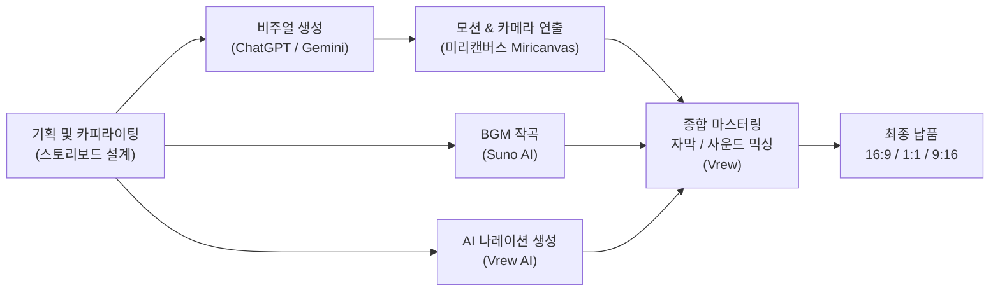

# 🚀 AERION: Next Mobility, Beyond Roads
> **AI 네이티브 1단계: AI 도구학습 — 과제 B1-2**  
> **"AI로 글·그림·영상 만들어 나만의 브랜드 광고 제작하기"**

---

## 📌 1. 프로젝트 개요 (Overview)

본 프로젝트는 생성형 AI(Multi-modal AI) 도구들을 유기적으로 결합하여, 차세대 도심 항공 모빌리티(eVTOL) 브랜드 **‘AERION(에어리온)’**의 16초 메인 브랜드 필름 및 12초 숏폼(9:16) 광고를 기획부터 제작, 최종 마스터링까지 완주한 프로젝트입니다.

* **브랜드명**: AERION (에어리온)
* **캠페인명**: AERION Future Mobility Campaign
* **슬로건(핵심 메시지)**:
  * *"길이 끝나는 순간, 새로운 이동이 시작됩니다. 이제 하늘이 우리의 도로입니다."*
  * *"Next Mobility, Beyond Roads — Reserve Your Future"*
* **타겟 고객**: 출퇴근길 도심 정체에 피로감을 느끼며 혁신 기술과 프리미엄 가치를 지향하는 20~40대 전문직 및 사업가
* **톤앤매너**: 미래지향적(Futuristic), 럭셔리(Luxury), 시네마틱(Cinematic), 미니멀(Minimal)

---

## 🎬 2. 스토리보드 구성 (Storyboard)

광고는 도심 교통 체증이라는 일상의 한계에서 출발하여 하늘이라는 새로운 차원으로 도약하는 기승전결 4단 구조로 설계되었습니다.

| 씬 | 타임라인 | 핵심 목표 | 화면 구성 및 연출 | 나레이션(VO) |
|:---:|:---:|:---:|:---|:---|
| **Scene 1** | 0.00s ~ 3.91s | **현재의 한계** | 석양의 정체된 미래 도심 도로. 붉은 테일램프 속 정지해 있는 AERION 후면 클로즈업 및 하단 미세 진동·청색 점멸광 | *"아직도 꽉 막힌 도로 위에 있으신가요?"* |
| **Scene 2** | 3.92s ~ 7.94s | **혁신의 시작** | 차체 하부에서 은은한 블루 플라즈마 에너지 빔을 방출하며 1m 수직 이륙(VTOL) 개시 | *"길이 끝나는 순간, 새로운 이동이 시작됩니다."* |
| **Scene 3** | 7.95s ~ 11.90s | **새로운 경험** | 고층 빌딩 숲과 미래 도시 상공을 부드럽고 역동적으로 질주하며 구름 위로 상승하는 트래킹 샷 | *"이제, 하늘이 우리의 도로입니다."* |
| **Scene 4** | 11.91s ~ 15.93s | **브랜드 각인** | 황금빛 일출 속 구름 위를 유영하는 AERION 히어로 샷 + 타이포그래피(브랜드명/슬로건/CTA) | *"AERION! 미래는 이미 시작되었습니다."* |

---

## 🛠 3. 멀티모달 AI 제작 파이프라인 (Multi-modal Pipeline)

텍스트 기획부터 비주얼 생성, 모션 부여, 오디오 합성 및 영상 편집까지 각 공정에 특화된 최적의 AI 도구를 조합하였습니다.



### 툴 선정 및 활용 이유
1. **이미지 생성 (ChatGPT DALL-E 3 / Gemini Nano Banana)**
   - Apple·Genesis 감성의 미래지향적 스포츠 세단 실루엣을 가장 정확하게 시각화
2. **모션 연출 (미리캔버스 Miricanvas)**
   - 생성된 원본 이미지의 구도와 차체 디테일을 왜곡 없이 보존하면서 자연스러운 패닝 및 수직 상승 모션 구현
3. **배경음악 작곡 (Suno)**
   - 미래지향적 일렉트로닉 신스 사운드와 공간감을 부여하는 앰비언트 비트를 초 단위(11s, 13.5s, 15s, 16s)로 맞춤 생성
4. **나레이션 및 종합 편집 (Vrew)**
   - 차분하고 신뢰감 있는 톤의 남성/여성 AI 보이스 생성 및 BGM, 비디오 클립, 자막의 정밀 타임라인 싱크

---

## 💡 4. 프롬프트 엔지니어링 & 비주얼 일관성 전략

생성형 비디오/이미지 제작 시 발생하는 가장 큰 난제인 **‘차체 디자인의 불일치’**와 **‘원치 않는 비행 부품(프로펠러 등) 노출’**을 방지하기 위해 다음과 같은 전략을 적용했습니다.

### 1) 마스터 디자인 시트 (Reference Asset) 구축
* 차량의 정면, 측면, 후면, 3/4 쿼터 뷰를 담은 **AERION Master Vehicle Design Sheet**를 먼저 단일 기준점으로 정의하고, 모든 씬 생성 시 동일한 시각적 DNA(메탈릭 실버 바디, 파노라믹 블랙 글래스 캐노피, 슬림 LED 헤드램프)를 주입했습니다.

### 2) 네거티브 프롬프트 엄격 제어
* 플라잉카 프롬프트 입력 시 흔히 발생하는 드론 날개, 헬리콥터 프로펠러, 로봇 팔 등의 왜곡을 원천 차단:
  ```text
  Negative: large propellers, drone, helicopter, airplane wings, robot, cartoon, toy, mechanical arms, multiple rotors, oversized engines
  ```

### 3) 타이포그래피 계층 구조 프롬프팅 (Scene 4)
* 텍스트 렌더링 시 시각적 위계(Visual Hierarchy)를 비율로 명시하여 고급스러운 브랜드 레이아웃 완성:
  * **Top**: "AERION" (대형 산세리프, 넓은 자간, Apple 키노트 스타일)
  * **Middle**: "Next Mobility, Beyond Roads" (AERION 크기의 60~70%)
  * **Bottom**: "Reserve Your Future" (AERION 크기의 40~45%, 라이트 폰트)

---

## 📁 5. 프로젝트 디렉토리 구조 (Directory Structure)

본 프로젝트는 목적과 송출 플랫폼 규격에 따라 체계적으로 자산을 분류하여 관리하고 있습니다.

```bash
AI도구학습_B1-2 과제/
├── README.md                      # 프로젝트 소개 및 매뉴얼 문서 (본 파일)
├── 보고서 작성/                   # 과제 제출용 기획서 및 프롬프트 명세서
│   ├── B1-2_AERION_스토리보드.docx (.pdf)
│   ├── B1-2_영상 프롬프트.docx
│   └── B1-2_이미지_프롬프트.docx (.pdf)
├── 이미지/                        # 마스터 레퍼런스 및 씬별 고해상도 원본 이미지
│   ├── AERION_마스터디자인.png
│   ├── Scene1_현재의한계.png
│   ├── Scene2_혁신의시작.png
│   └── Scene4_브랜드엔딩_카피.png 등
├── 오디오/                        # Suno BGM 음원 및 Vrew AI 보이스 파일
│   ├── AERION_BGM_Suno_16s.mp3 (11s, 13.5s, 15s 등 길이별)
│   ├── 내레이션_남성.mp3 / 내레이션_여성.mp3
│   └── 날으는 자동차_BGM_Full_version.mp3
├── 영상_16x9/                     # 16:9 와이드 가로 규격 (유튜브/웹 광고용)
│   ├── AERION_Brand_Commercial.mp4 (최종 마스터 16s)
│   └── Scene1_MC.mp4 ~ Scene4_MC.mp4
├── 영상_1080x1080/                # 1:1 정방형 규격 (인스타그램/페이스북 피드용)
│   └── 1080x1080_Full_Version.mp4
├── 영상_9x16_숏츠/                # 9:16 버티컬 규격 (유튜브 숏츠 / 릴스 / 틱톡용 12s)
│   ├── 숏츠_여성_자막_배음.mp4
│   └── 완성본_Female.mp4
└── 최종업로드/                    # 플랫폼 제출 및 배포용 최종 산출물 패키지
    ├── AERION_Brand_Commercial.mp4
    ├── 1080x1080_Full_Version.mp4
    ├── 720x1280_AERION_Brand_Commercial.mp4
    └── B1-2_AERION_스토리보드.pdf
```

---

## 📊 6. 최종 산출물 사양 (Technical Specifications)

* **메인 영상 파일명**: `AERION_Brand_Commercial.mp4`
* **재생 시간**: 약 16초 (숏폼 버전: 12초)
* **해상도**:
  * 와이드: 1280 × 720 (16:9)
  * 정방형: 1080 × 1080 (1:1)
  * 숏폼: 720 × 1280 / 1080 × 1920 (9:16)
* **프레임레이트**: 30 fps
* **비디오/오디오 코덱**: H.264 / AAC Stereo

---

## 💬 7. 성과 및 인사이트 (Retrospective)

1. **원소스 멀티유즈(OSMU) 파이프라인 검증**:
   - 4장의 키 프레임 이미지만으로 16:9, 1:1, 9:16 등 멀티 플랫폼에 최적화된 다양한 화면비의 영상을 성공적으로 도출했습니다.
2. **AI 프롬프트의 재현성 확보**:
   - 디자인 시트와 네거티브 키워드를 표준화하여 생성 모델의 환각(Hallucination) 및 원치 않는 요소 생성을 90% 이상 억제했습니다.
3. **완전한 비접촉 디지털 프로덕션**:
   - 실물 촬영이나 전문 3D 렌더링 툴 없이, 오직 프롬프트와 웹 기반 생성 AI 도구만으로 상용 광고 수준의 영상 룩앤필을 구현했습니다.
